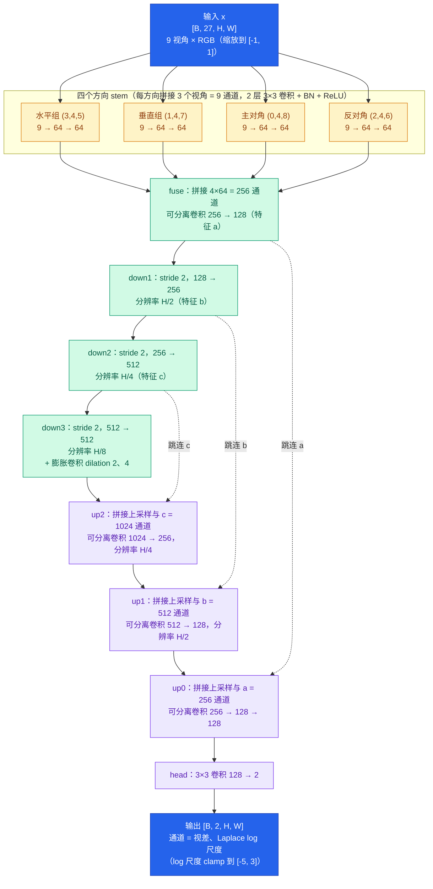

# Lightfield LiteNet

3×3 RGB 光场深度网络，1,920,002 参数。官方工具八场景 BadPix(0.07) 均值为 **9.4799%**。

## 训练

依赖：Python、支持 CUDA 的 PyTorch 2.8、NumPy、Pillow、PyYAML。

在配置 `configs/train_stem2_step2_2m_batch32_angularmix_3090.yaml` 中将 `dataset_root` 改为 HCI 数据集目录（包含 additional、training、stratified、test），然后在项目根目录运行：

```bash
python train.py
```
batch size 32，200 轮，AngularMix、几何增强及噪声/对比度增强均已包含。
`assets/epinet_masks` 是训练必需的反射区域掩码。

## 权重与接口

- 权重：`weights/best.pt`；网络定义：`lfnav/model.py`。
- 加载：`state = torch.load("weights/best.pt", map_location="cpu", weights_only=True)`，然后 `model = build_model(state["config"])`，`model.load_state_dict(state["model"])`。`build_model` 从 `lfnav.model` 导入。
- 输入：`[B,27,H,W]`，九视角按行排列，每视角 RGB，float32、范围 `[0,1]`。
- HCI 9×9 取行列 `[2,4,6]`（从 0 开始，step=2）。输出为视差及对数误差尺度 `[B,2,H,W]`；

## 网络结构图



## ROS 2 推理（Ubuntu 24.04 / Jazzy）

包名 `lightfield_litenet`，节点 `depth_node`。保留原训练入口；ROS 推理只用 ONNX，不依赖 PyTorch。
将整个项目放在 `~/ros2_ws/src/lightfiled-LiteNet`。已安装 ROS 2 Jazzy 后：

```bash
source /opt/ros/jazzy/setup.bash
sudo apt install python3-colcon-common-extensions python3-rosdep python3-venv
python3 -m venv --system-site-packages ~/venvs/litenet_ros
source ~/venvs/litenet_ros/bin/activate
python -m pip install onnxruntime colcon-common-extensions
cd ~/ros2_ws
rosdep install --from-paths src --ignore-src -r -y
colcon build --symlink-install --packages-select lightfield_litenet
source install/setup.bash
```

若 rosdep 未初始化，先执行 `sudo rosdep init` 和 `rosdep update`。
CPU 环境安装 `onnxruntime`；NVIDIA GPU 环境改装匹配 CUDA/cuDNN 的 `onnxruntime-gpu`（二选一），启动传 `provider:=cuda`。`auto` 优先 CUDA，否则警告并使用 CPU。

复制 `configs/ros_camera_template.json`，填入实际标定，运行：

```bash
ros2 launch lightfield_litenet depth.launch.py calibration:=/absolute/path/camera.json provider:=auto use_sim_time:=true
```

真实相机改为 `use_sim_time:=false`；仿真必须发布 `/clock`。默认模型为包内 `weights/best.onnx`。
也可直接使用 `ros2 run lightfield_litenet depth_node --ros-args -p calibration:=/absolute/path/camera.json -p provider:=cpu`。
换终端需重新激活 venv 并 source ROS 和工作空间环境。

### 输入与输出

输入 `/lf/image_grid` 为 `sensor_msgs/Image`，`rgb8` 或 `bgr8`，大小 **1536x1536**：九张同步、已校正的 512x512 图像按 3x3 拼图排列，不是将单张图拉伸。
仿真/相机端负责九视角同步和拼接；输入 `frame_id` 必须等于标定中的中心相机光学坐标系，时间戳为采集时间。节点不包含相机驱动、TF 或导航规划。

| 话题 | 类型 / 含义 |
|---|---|
| `/lf/disparity` | Image `32FC1`，原始 HCI 相邻视角单位的视差 |
| `/lf/uncertainty_scale` | Image `32FC1`，Laplace 视差误差尺度，不是置信概率 |
| `/lf/depth` | Image `32FC1`，米制 Z 深度；无效处 NaN |
| `/lf/valid` | Image `mono8`，255 有效、0 无效 |
| `/lf/camera_info` | CameraInfo，中心视角标定 |
| `/lf/points` | PointCloud2，米制 XYZ，中心光学坐标系（右、下、前） |
| `/diagnostics` | DiagnosticArray，延迟与有效覆盖率 |

图像/点云使用 best-effort、队列深度 1；订阅端使用 SensorDataQoS。输出沿用输入时间戳。接导航时由机器人端提供中心相机到 base_link/map 的 TF。

### 标定与检查

`selected_baseline_m` 填所选 3x3 中相邻相机的实际间距（水平、垂直应相等）。本权重的 `angular_step=2`，转换使用 `B=selected_baseline_m/2`，`Z=fx*B/(disparity_sign*d+disparity_offset_px)`。offset 与网络输出使用相同视差单位；不能直接套任意相机的参数，需匹配校正/零视差平面约定。
`ros_hci_museum_example.json` 仅用于对应 HCI museum 图像的接口演示，不能用于机器人。真实/仿真相机先用已知距离平面验证深度尺度、符号与视角顺序。

```bash
ros2 topic info /lf/image_grid -v
ros2 topic hz /lf/depth
ros2 topic echo /diagnostics
```

RViz 中添加 PointCloud2 `/lf/points`，可靠性选 Best Effort，Fixed Frame 使用标定 `frame_id`（或已有 TF 的 map）。
默认过期阈值 `max_age=1.0` 秒，可按运行频率设置；未知区域不能视为可通行。诊断节点不发送停车命令。
本机已做数值与接口测试；完整 colcon/ROS 话题联调需在安装 ROS 2 的 Linux 环境进行。
